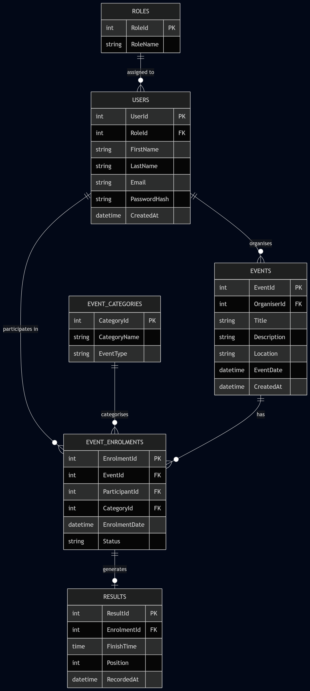

# RaceDay — Event Management System

## Overview
RaceDay is an event management platform developed for the IIE Portfolio of Evidence (PoE). The system is built to streamline the administrative overhead of sporting events—such as road runs, cycling races, and community walks—by managing participant enrolments, event scheduling, category allocations, and official finish results in a centralized database.

The platform distinguishes between two primary user roles:
* **Organisers:** Administrative users who design events, define sub-categories (e.g., 10km Run vs. 21km Half Marathon), manage enrolment caps, and log verified race results.
* **Participants:** End users who browse upcoming race events, register for specific categories, and track their personal race finish times and historical rankings.

---

## System Architecture & Key Components

### 1. Database Schema (/docs/RaceDay_Database.sql)
The backend database architecture is built on Microsoft SQL Server using structured DDL scripts. It enforces referential integrity through standard primary-foreign key relationships across six core tables:
* Roles: Defines permission levels (Organiser, Participant).
* Users: Stores user identity profiles and hashed security credentials.
* EventCategories: Classifies event distance and discipline options.
* Events: Contains event details including location, dates, and assigned organisers.
* EventEnrolments: Links participants to specific events and categories while preventing duplicate entries using composite unique constraints.
* Results: Captures finish times, numerical rankings, and timestamps for completed event entries.

### 2. Entity Relationship Diagram (/docs/ERD_Diagram.png)
The visual schema maps out the database normalization (up to 3NF) and cardinalities between entities:



### 3. API Specification (/docs/API_Endpoints.md)
The RESTful API architecture outlines the communication layer between client applications and the database. It documents endpoints for authentication (JWT), user profile management, event listing, enrolment processing, and result entry.

### 4. Automated CI Pipeline (/.github/workflows/validate-docs.yml)
To maintain repository quality, an automated GitHub Actions pipeline runs on every push to the primary branch. The workflow validates the project's folder layout and ensures essential SQL and documentation files remain intact within the /docs directory.

---

## Directory Layout

```text
RaceDay/
├── .github/
│   └── workflows/
│       └── validate-docs.yml    # CI build validation script
├── docs/
│   ├── API_Endpoints.md         # API route specifications and HTTP contract
│   ├── ERD_Diagram.png          # High-resolution database entity relationship diagram
│   └── RaceDay_Database.sql     # Complete SQL creation script and seed data
├── LICENSE                      # Open-source MIT license terms
└── README.md                    # Project overview and system documentation
